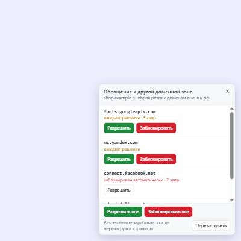

<p align="center">
  
</p>

<h1 align="center">RU-защита</h1>

<p align="center">
  Браузерное расширение, которое не даёт сайтам в зонах <b>.ru</b> и <b>.рф</b> молча обращаться к серверам за их пределами.
</p>

---

Типичный российский сайт при открытии загружает данные с десятков посторонних доменов: шрифты, CDN, счётчики, рекламные и трекинговые скрипты. **RU-защита** показывает каждое такое обращение за пределы .ru/.рф и оставляет решение за вами: разрешить домен или заблокировать его. Блокировку можно и полностью автоматизировать.

<p align="center">
  
</p>

## Возможности

- 🛡 **Перехват обращений к другим зонам**: скрипты, стили, шрифты, картинки, fetch/XHR, iframe, WebSocket, beacon.
- 🔔 **Запрос в правом нижнем углу** с доменом и кнопками «Разрешить» / «Заблокировать», а при нескольких доменах ещё и «все сразу».
- ⚡ **Автоматическая блокировка** всего внешнего, кроме разрешённых доменов.
- 📋 **Белый и чёрный списки**: решения запоминаются и действуют на все сайты .ru/.рф вместе с поддоменами.
- 🔢 **Счётчик на значке**: сколько внешних доменов заблокировано на текущей вкладке.
- 🎨 Светлая и тёмная тема. Уведомление изолировано в Shadow DOM, поэтому стили сайта его не ломают.
- 🔒 Никаких серверов и аналитики: всё работает локально в браузере.

## Режимы

Режим выбирается двумя переключателями во всплывающем окне расширения:

| Показывать уведомление | Блокировать автоматически | Поведение |
|:-:|:-:|---|
| ✅ | ❌ | **Режим вопроса.** Новый внешний домен блокируется до вашего решения, справа внизу появляется запрос. |
| ✅ | ✅ | Всё внешнее блокируется сразу, уведомление сообщает, что было заблокировано, и позволяет разрешить домен в один клик. |
| ❌ | ✅ | Тихая блокировка, видно только число на значке. |
| ❌ | ❌ | Пассивный режим: блокируются только домены из чёрного списка. |

## Установка

Скачайте репозиторий: **Code → Download ZIP** — и распакуйте его. Или выполните `git clone https://github.com/Noname316/RU-protection.git`.

### Chrome, Яндекс Браузер, Edge, Opera, Brave

Нужен браузер на основе Chromium 121 или новее.

1. Откройте страницу расширений:
   - Chrome / Brave: `chrome://extensions`
   - Яндекс Браузер: `browser://extensions`
   - Edge: `edge://extensions`
2. Включите **Режим разработчика**.
3. Нажмите **Загрузить распакованное расширение** и выберите папку с проектом.

### Firefox

Нужен Firefox 128 или новее.

1. Откройте `about:debugging#/runtime/this-firefox`.
2. Нажмите **Загрузить временное дополнение…** и выберите файл `manifest.json` из папки проекта.

Временное дополнение удаляется при закрытии Firefox. Чтобы установить его насовсем, упакуйте содержимое папки в ZIP и подпишите на [addons.mozilla.org](https://addons.mozilla.org/developers/). Для этого подходит вариант «самостоятельное распространение»: без публикации в каталоге, на выходе получается `.xpi`.

Если во всплывающем окне появилось сообщение «Расширению не выдан доступ к сайтам», нажмите **Выдать доступ**. В Firefox этот доступ можно отозвать в настройках дополнения, а без него расширение не видит обращения страниц.

## Как это работает

```
сайт.ru ──► запрос к fonts.googleapis.com
              │
              ├─ declarativeNetRequest: блокировать, если инициатор в .ru/.рф,
              │  а адрес вне .ru/.рф и не в белом списке
              │
              └─ webRequest (наблюдение) ──► уведомление на странице + значок
```

| Файл | Назначение |
|---|---|
| `background.js` | Service worker: строит правила `declarativeNetRequest`, ведёт учёт внешних доменов по вкладкам, хранит списки |
| `content.js` | Уведомление в правом нижнем углу страниц .ru/.рф |
| `popup.html` / `popup.js` / `popup.css` | Переключатели, домены текущей страницы, белый и чёрный списки |

Зона .рф в правилах записана в punycode: `xn--p1ai`.

Один и тот же код работает в Chromium и Firefox: API берётся из `browser` или `chrome`, а в манифесте фоновый скрипт объявлен и как `service_worker` (Chromium), и как `scripts` (Firefox).

## Ограничения

- **Разрешённое начинает работать после перезагрузки.** В Manifest V3 расширение не может приостановить запрос до ответа пользователя. Поэтому в режиме вопроса домен сначала блокируется, а после нажатия «Разрешить» появляется кнопка «Перезагрузить».
- **Переходы по ссылкам не блокируются.** Расширение фильтрует только ресурсы, которые загружает страница, а не навигацию.
- **Решения действуют на все сайты.** Разрешённый домен разрешён для всех сайтов .ru/.рф, а не для одного.

## Права расширения

| Право | Зачем |
|---|---|
| `declarativeNetRequest` | Блокировать запросы |
| `webRequest` + доступ ко всем сайтам | Видеть, к каким доменам обращается страница (только чтение) |
| `storage` | Хранить настройки и списки |
| `tabs` | Определить текущую вкладку во всплывающем окне |
